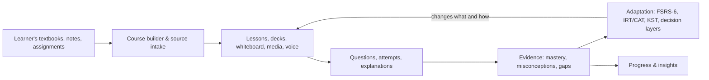

# Luminest

**A learning harness that connects the materials a student already has, the instruction they receive, the evidence their work produces, and the adaptations that follow.**

Luminest is a native macOS application (SwiftUI) with a separate FastAPI backend. It is not a chatbot wrapper: the course graph, the lesson procedure, the question bank, the memory scheduler and the classroom state machine are separate parts of the system, and each records what it did. The app bundle is named **Luminfest**; the project and repository are named **Luminest**.

`macOS 14+` · `Swift 6` · `FastAPI` · `SQLite / PostgreSQL` · `51 registered agent tools`


---

## The idea

Most learning software has some of these pieces. Luminest is built around the *connections* between all four:

| | Pillar | What it means here | Where it lives |
|---|---|---|---|
| **01** | **Learning materials** | The student's own textbooks, notes, assignments and links become a course: concepts, prerequisites, questions and lessons. No dev-authored content is required. | `backend/app/routes_create.py`, `routes_source.py`, `course_builder.py`, `generated_curriculum.py` |
| **02** | **Intelligent learning** | Personalized instruction, practice, feedback and misconception detection. A lesson is a compiled plan of activities, not a chat transcript. | `backend/app/harness/loop.py`, `routes_procedure.py`, `learning.py`, `curriculum.py`, `harness/socratic.py`, `harness/toolbox.py` |
| **03** | **Learning intelligence** | Progress tracking, evidence of mastery, and identification of knowledge gaps. An answer writes an attempt; the attempt moves a learning state. | `backend/app/learning.py`, `learning_science.py`, `knowledge_graph.py`, `harness/psychometrics.py`, `kst.py` |
| **04** | **Continuous adaptation** | What and how the student learns changes with demonstrated understanding: FSRS-6 scheduling, IRT/CAT, knowledge-space theory, and five decision layers that decide whether to interrupt. | `backend/app/memory.py`, `flashcards.py`, `harness/classroom.py`, `harness/teaching/supervision.py`, `harness/guided_sim.py` |



The full diagram is also available as [a standalone SVG](docs/assets/architecture.svg).

Three design rules are enforced across the codebase, because violating them still runs and quietly harms learners:

- **Decision layers never collapse.** `teaching/policy` decides what to teach, `session` owns the phase and turn, `procedure` owns activities, `supervision` decides whether to interrupt, and `classroom` is the state machine that imports supervision's primitives.
- **`mastery_known` is not `mastery`.** A `PRIOR` of 0.15 means *no attempts yet*, not *the learner knows 15%*.
- **Absence is designed.** A missing model provider degrades to a declared fallback with a stated reason. It never raises and never fabricates an answer.

---

## Demo

[](docs/assets/luminest-walkthrough.mp4)

The [walkthrough video](docs/assets/luminest-walkthrough.mp4) (50 s, 1440×900) is assembled from **real, unretouched captures of the running macOS app**, taken from the release build on 2026-10-19. It is a narrated walkthrough, not a continuous screen recording — each frame is one of the screenshots below, with a provenance label. The closing card reports the dated end-to-end run described under [Testing evidence](#testing-evidence).

---

## Screenshots

All eight are real captures from the running native app, not mockups or renders.

| | |
|---|---|
|  |  |
| Today · the next step with its stated reason | Knowledge map · concepts, strands and coverage |
|  |  |
| Practice · one question at a time | Feedback · grading and explanation |
|  |  |
| Tutor · retrieved-curriculum response when no generative model is configured | Daily review · spaced scheduling |
|  |  |
| Insights · mastery evidence | Courses · choosing what to study |

---

## Features

**Materials and course design**

- Create a course from pasted text, an uploaded file, or a web source: `POST /api/v1/create/preview`, `/create/course`, `/create/upload`, `/create/auto`.
- Generated curriculum: concept graph, prerequisite sequence, question bank, and lessons compiled into a procedure plan.
- Authored-course foundry for teacher-prepared material, with a rebuild path.

**Instruction and practice**

- Compiled lesson procedures with ordered activity blocks; a plan only promises artifacts that already exist (missing ones become `skipped`).
- Multiple-choice practice with distractor-level diagnosis (concept / procedure / calculation), explain-back and variant questions.
- Tutor chat, streaming agent turns, and a Socratic ladder; with no model provider the tutor serves retrieved curriculum and reports a named `model-required` state rather than fabricating an answer.
- Editable slide decks with real `.pptx` export, whiteboard/board editor with diagrams and images, image search with licence gating, TTS narration, and interactive simulations.

**Evidence and insight**

- Every graded answer writes an `Attempt`; learning states, review history and knowledge-graph coverage update from it.
- FSRS-6 spaced repetition (`memory.py`), IRT/CAT calibration (`harness/psychometrics.py`), knowledge-space theory (`kst.py`), and BKT-style mastery updates.
- Insights, knowledge-map coverage, diagnostics, and account export.

**Adaptation and honesty**

- Five separate decision layers, with supervision deciding *whether to interrupt* rather than *what to teach*.
- An unconfigured instance reports a `model-required` state and serves retrieved curriculum with a named reason; it never fabricates a generated answer.
- Configurable tutor provider, local VoiceStudio TTS, Chromium-based web/video discovery without an API key, and optional duplex voice via an OpenAI Realtime key.

A capability → file → test map is maintained in [`harness/context/01-repo-map.md`](harness/context/01-repo-map.md) and [`02-interfaces.md`](harness/context/02-interfaces.md).

---

## Architecture

```
harness/
├── native/            SwiftUI macOS app (macOS 14+, Swift tools 6.0)
├── backend/           FastAPI app, SQLAlchemy models, tests, migrations
│   ├── app/           routes, services, and the harness/ decision layers
│   ├── requirements*.txt
│   └── scripts/       schema init, backup drill, local-service bootstrap
├── web/               static browser workbench (no build step)
├── docs/              design notes, SSOT documents, setup guides
├── context/           generated, compressed repository map for agents
├── scripts/           quality, packaging, QA and media tooling
└── ui-tests/          XCUITest target and native journey runner
```

The backend is the single source of truth for learning state; the native app is a client, not a second implementation of the science. HTTP routes own request/response only; business rules live in services so the desktop bundle, the browser workbench and the tests exercise the same code.

Further reading: [supervision](harness/docs/supervision.md), [classroom decision engine](harness/docs/classroom-decision-engine.md), [lesson procedure](harness/docs/lesson-procedure.md), [authoring foundry](harness/docs/authoring_foundry.md), [TA assets](harness/docs/ta-assets.md), [realtime voice and setup](harness/docs/REALTIME_VOICE_AND_SETUP.md), [local services](harness/docs/LOCAL_SERVICES.md), [distribution and signing](harness/DISTRIBUTION.md).

---

## Installation

**Requirements:** macOS 14 or newer, Xcode / Swift tools 6.0, Python 3 with `venv`, and (optionally) VoiceStudio for local TTS and Playwright Chromium for web/video discovery.

### 1. Backend + browser workbench

```bash
git clone https://github.com/tengyic/luminest.git
cd luminest/harness

# Creates backend/.venv, installs the declared runtime packages,
# checks the optional local services, and starts FastAPI on 127.0.0.1:8877.
scripts/start_local_services.sh --serve

# In another shell:
curl http://127.0.0.1:8877/health
```

The script sets `HARNESS_AUTO_CREATE=1`, so a fresh SQLite database is created on first launch. For an explicit schema upgrade on an existing database, run `python3 backend/scripts/init_db.py` with `backend/` as the working directory. The static browser workbench is served at `/` by the same backend.

### 2. Native macOS app

```bash
cd harness/native
swift build --disable-sandbox        # nested sandbox-exec requires this flag
```

To bundle and launch it, run `sh harness/native/package_app.sh` from the `harness/` directory. The app discovers its backend on ports **8765–8785**, so for a dev backend either start the services with an in-range port (`PORT=8770 scripts/start_local_services.sh --serve`) or point the app at your own endpoint via the `luminfest.endpoint` user default.

### 3. Tests

```bash
cd harness/backend
python3 -m venv .venv
.venv/bin/pip install -r requirements.txt -r requirements-dev.txt
.venv/bin/python -m pytest -q
```

The dev requirements matter: `hypothesis`, `pandas` and `pytest-timeout` are needed for the property-based tests and the per-test timeout ceiling. Without them the suite fails at collection or runs without its configured ceiling. Run tests with `backend/` as the working directory and a temp directory inside the workspace.

Environment and provider options are documented in [`docs/LOCAL_SERVICES.md`](harness/docs/LOCAL_SERVICES.md) and [`REALTIME_VOICE_AND_SETUP.md`](harness/docs/REALTIME_VOICE_AND_SETUP.md). No API key is needed to browse retrieved curriculum; a model provider is required for generated tutor answers.

---

## Testing evidence

Evidence is committed, dated and machine-readable in [`docs/evidence/`](docs/evidence/README.md). **Every row states what it covers, how much that is, the commit it was measured on, and how to reproduce it.** A number without those four is not a measurement; it is a recollection, and this table no longer publishes any.

| Check | Date | Covers | Commit | Result |
|---|---|---|---|---|
| Backend suite — shipping branch, **after** the fix | 2026-11-12 | all 122 test files, 2,291 collected | `c35d24f` | **2,289 passed / 0 failed / 2 skipped**, 8 warnings, 14 m 49 s, `PYTEST_EXIT=0`. The two skips are explicit opt-in live-provider smokes. [Raw log, collection and reproduction](docs/evidence/full-suite-2026-11-12/) |
| Backend suite — shipping branch, before the fix | 2026-11-11 | all 122 test files, 2,291 collected | `ab8bcda` | **2,286 passed / 3 failed / 2 skipped.** All three failures were real and were fixed in `a7bfb6d`; the aggregate after the fix is the row above, not an inference |
| Backend suite — `main` | 2026-11-11 | all 101 test files, 1,838 collected | `bbbe2e4` | **1,835 passed / 1 failed / 2 skipped.** The one failure is `test_packaging_manifest` comparing `requirements.txt` against the *local* venv (Pillow 13.0.0 installed vs 12.3.0 declared, python-multipart 0.0.31 vs 0.0.22) — an environment artefact, not code on `main` |
| Release gate, **layers 1–2 only** | 2026-11-11 | **9 of 122 test files (7.4%)**: 66 unit + 47 integration | `a7bfb6d` | **PASS** — 113 passed, 0 failed, 0 skipped, 71 s. This is a *subset*, chosen for speed; it is not the suite |
| First-person acceptance run | 2026-11-11 | 29 steps, fresh database, unseen topic, provider explicitly unconfigured | `a7bfb6d` | **29 / 29 steps passed** |
| Native UI layer (gate layer 3) | 2026-11-12 | 10 golden journeys in the rebuilt real app, with an isolated backend and database | `c35d24f` | **NOT GREEN — 6 passed / 1 blocked / 3 failed / 0 gaps**, 3 m 03 s, `databaseVerified: true`. J4 is blocked (no review due on a fresh account); J8/J9/J10 failed. [Evidence and per-journey notes](docs/evidence/native-layer3-2026-11-12/) |

Reproduce, in order:

```sh
# the full suite, one process (the 2026-11-12 row: 14m49s on this host).
# TMPDIR and --basetemp must be inside the workspace; PYTHONPATH must be unset.
mkdir -p outputs/qa/tmp
cd harness/backend
env -u PYTHONPATH TMPDIR="<workspace>/outputs/qa/tmp" PYTHONDONTWRITEBYTECODE=1 \
  .venv/bin/python -m pytest -q -rs -p no:cacheprovider \
  --basetemp="<workspace>/outputs/qa/bt"

# sharded alternative if a busy machine kills the single process
cd harness/backend
for f in tests/test_*.py; do echo "$f"; done | split -l 31 - chunk-
for c in chunk-*; do env -u PYTHONPATH .venv/bin/python -m pytest -q -p no:cacheprovider \
  --basetemp="<workspace>/outputs/qa/pt-$(basename $c)" $(cat $c | tr '\n' ' '); done

# the gate as published (the runner lives on feature/a11y-i18n, not on main)
cd harness && python3 scripts/quality_gate.py --layers 1,2

# layer 3: rebuild first, then drive the ten journeys in a fresh output directory
cd harness/native && env -u PYTHONPATH swift build --disable-sandbox
cd .. && env -u PYTHONPATH backend/.venv/bin/python scripts/native_qa.py --journeys \
  --app native/.build/debug/LearningHarness \
  --backend-python backend/.venv/bin/python --port 8891 \
  --output <fresh-empty-directory> --timeout 900

# the journey: needs a backend on --base-url, started with a fresh data dir
HARNESS_ENV=test HARNESS_TUTOR_PROVIDER= \
  python3 harness/scripts/first_person_run.py --base-url http://127.0.0.1:8798 \
  --database /tmp/fp/h.sqlite3 --output /tmp/fp-out
```

**What the first-person run actually shows.** It registered a brand-new learner, confirmed the topic was absent from the curriculum, generated a course from that topic (*creep deformation of titanium aluminide turbine blades*), started a lesson, served a signed question, graded an answer, moved the learning state, recompiled the plan, spoke a real MP3, ended with a summary, and then exercised the unit grade book and written perspective evidence over HTTP. Database rows went `attempts: 0 → 1`, `learning_states: 0 → 1`, `created_courses: 0 → 1`.

It is **not** a like-for-like improvement on the earlier 17/20 run: the runner itself changed (18 steps unchanged, 2 re-specified, 9 added), so the scores are not comparable. The three failures the older run recorded are worth keeping in view: an agent turn on a wholly unseen topic still returns `unavailable` without a provider, the generated lesson still has no worked example, and block completion still does not itself write an attempt.

**Known limitations, stated plainly:**

- **No model, no generation.** A fresh clone boots *unconfigured*: a small configuration layer takes a provider, model and key at runtime (`/api/v1/settings/model-config`, four presets, no restart), but nothing requires you to set one. Until you do, the tutor teaches from retrieved curriculum, which is genuinely useful for a concept the pack covers and refuses — with a named reason — for a topic it has never seen. `HARNESS_TUTOR_PROVIDER=offline` no longer exists; production refuses to boot without a model.
- **Content is mostly generated, not authored.** 30 of 2,205 graph nodes carry a hand-written lesson (all in `integrated_math_1`); the other 2,041 get a four-block generated lesson with no worked example, and the tutor says so. The authoring audit has never run (`overlay_concepts: 0` everywhere). Breadth is not depth.
- **Camera capture and on-camera recording do not exist.** A learner can submit a project with text, a reflection and an AI-use disclosure, and get formative rubric feedback; there is no camera or recording path, and no certified grade. Creativity, collaboration and soft-skills analytics are human-written 0–4 observations with written evidence — null until a person writes one — and a teacher's group observation is an API call, not a native screen.
- **Simulation execution is unverified in the bundle.** Playwright is deliberately excluded from the shipped app (≈40 MB plus a Chromium download), so the packaged check validates a simulation's licence and URL and reports that runtime behaviour is unknown. `observable` is `false` by construction: free PhET has no telemetry.
- **Duplex realtime voice** requires an OpenAI Realtime key, and the VAD is heuristic.
- **Not a public release.** `security find-identity -v -p codesigning` reports 0 identities on the build machine, so `release_kit.py` refuses; legal text now has 0 placeholders, but signing and notarization are still required ([DISTRIBUTION.md](harness/DISTRIBUTION.md)).
- **A skip is not a pass, and the gate now enforces it.** The gate parses each layer's skipped-test count and blocks the verdict on it, at every strictness level — a test-level skip used to sail through because pytest exits 0. A layer that was not run at all blocks unconditionally.
- **This is not certification.** The gate covers 7.4% of the test files and its runner is not on `main`. A green full-suite aggregate is now archived, but it is on the development commit `c35d24f`, not on `main`, whose row still has its one environment-artefact failure. The native client is now exercised rather than unmeasured, but layer 3 is **not green** (6 of 10 journeys passed). Read this as evidence of specific behaviour on specific dates, not as a statement that the product is fit to ship.

The gate runner lives on the `feature/a11y-i18n` development branch; the snapshots themselves — `GATE.md` and `gate.json` — are committed in `docs/evidence/`, including the 2026-11-11 run this table cites. The two 2026-11-12 rows add [`full-suite-2026-11-12/`](docs/evidence/full-suite-2026-11-12/) and [`native-layer3-2026-11-12/`](docs/evidence/native-layer3-2026-11-12/); both hold raw logs and JSON, not just prose.

---

## Repository layout

- `harness/` — the application (native client, backend, web workbench, tests, docs, scripts).
- `reference/` — prior-app notes and knowledge-tracing reference material.
- `docs/assets/` — real screenshots, the walkthrough video, and the architecture diagram.
- `docs/evidence/` — dated test and acceptance evidence.

For a compressed, agent-friendly map of the codebase, start with [`harness/context/00-use-this.md`](harness/context/00-use-this.md). It is generated by `harness/scripts/context_pack.py` and should be regenerated at the start of a work session; it is derived, so staleness is its one failure mode.

---

## Status

This is an actively developed research prototype. The learning loop works end-to-end and is evidenced above; the surrounding release, legal and provider-integration work is not finished. See [`harness/context/04-open-gaps.md`](harness/context/04-open-gaps.md) for the curated gap audit and [`harness/REBUILD_PROMPT.md`](harness/REBUILD_PROMPT.md) for the current engineering brief.

No license file is published yet; until one is added, all rights are reserved by the repository owner.
