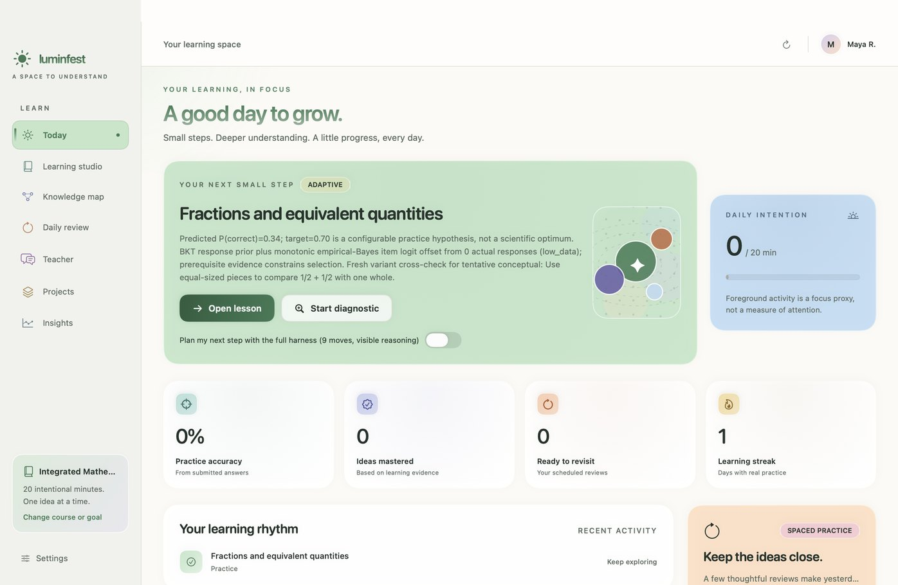
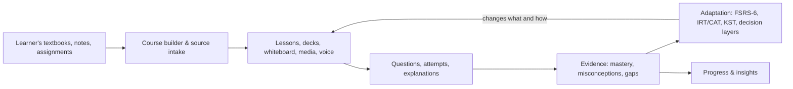
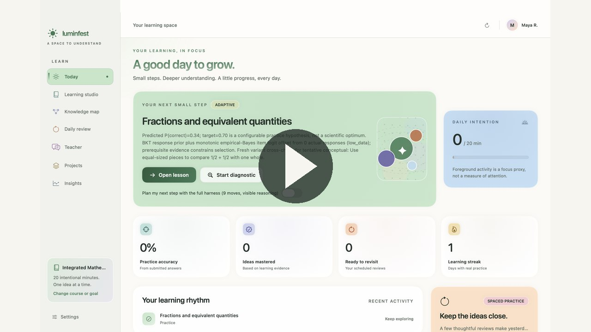
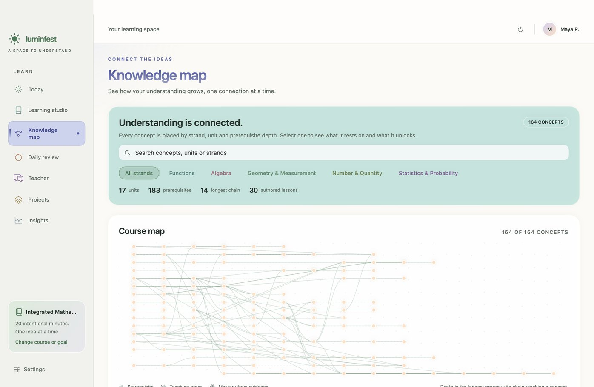
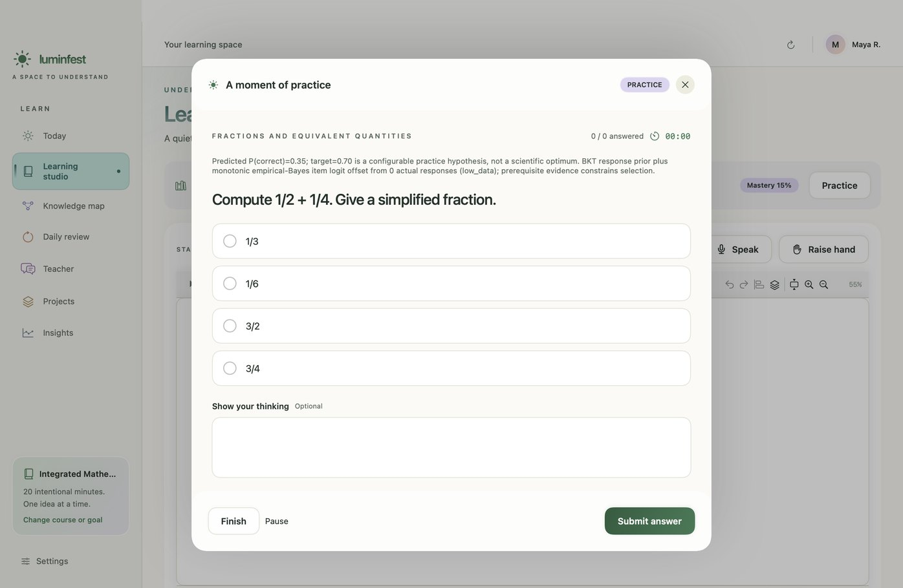
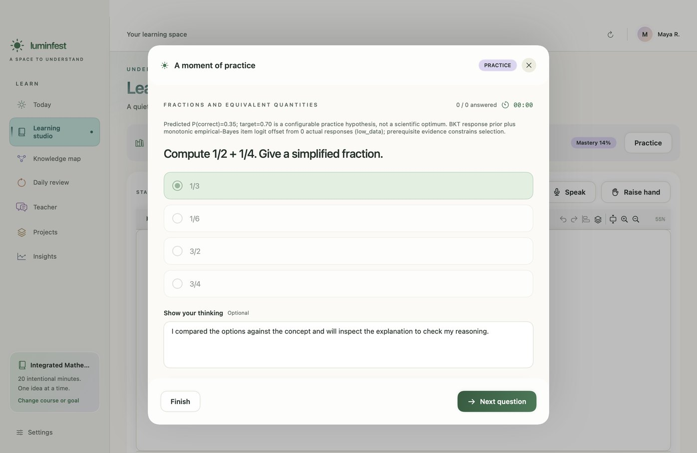
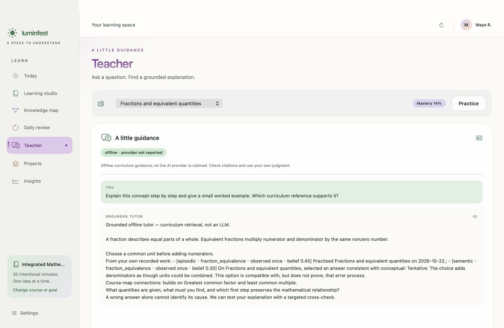
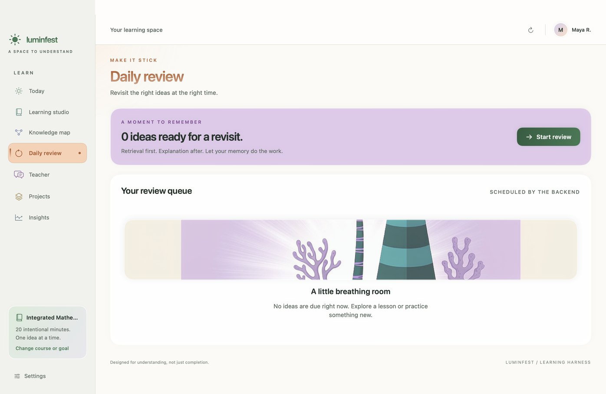
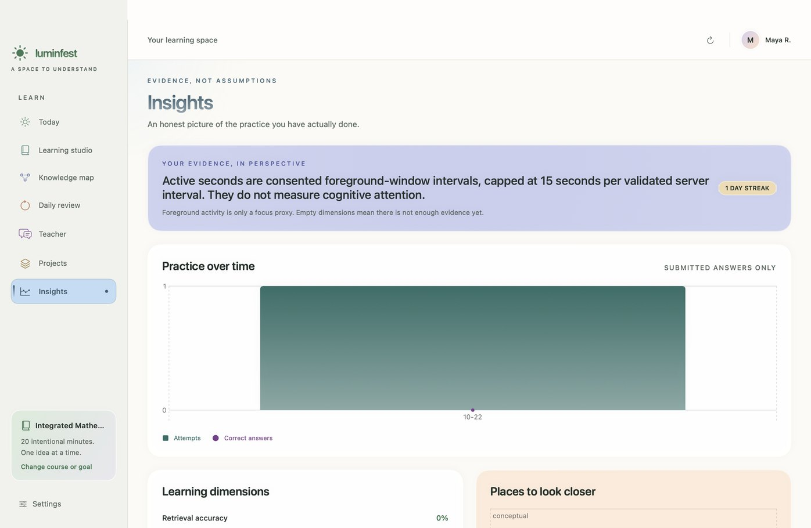
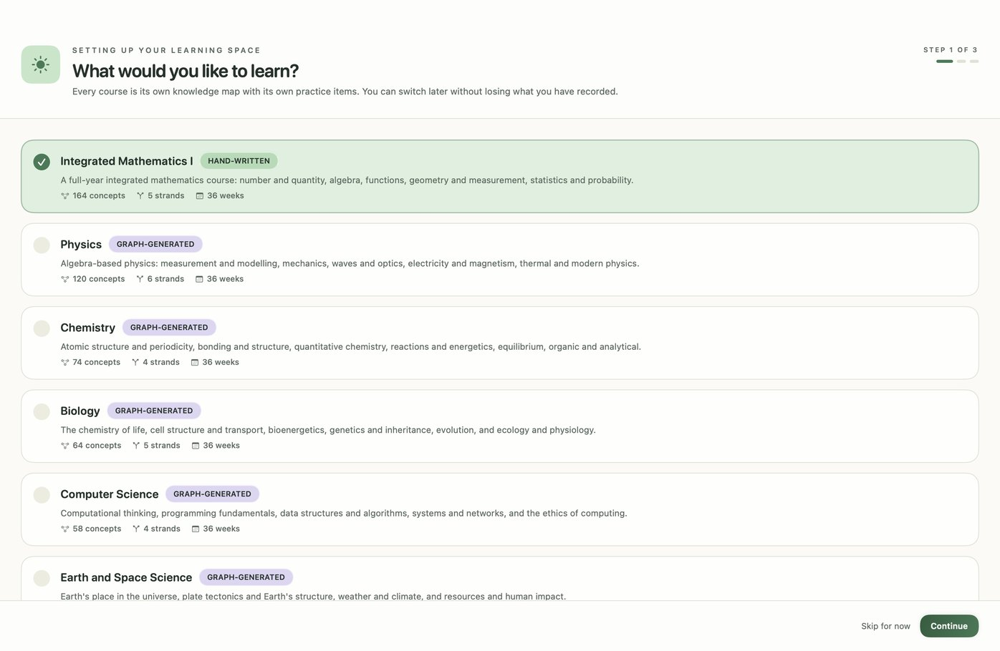

# Luminest

**A learning harness that connects the materials a student already has, the instruction they receive, the evidence their work produces, and the adaptations that follow.**

Luminest is a native macOS application (SwiftUI) with a separate FastAPI backend. It is not a chatbot wrapper: the course graph, the lesson procedure, the question bank, the memory scheduler and the classroom state machine are separate parts of the system, and each records what it did. The app bundle is named **Luminfest**; the project and repository are named **Luminest**.

`macOS 14+` · `Swift 6` · `FastAPI` · `SQLite / PostgreSQL` · `51 registered agent tools`



---

## The idea

Most learning software has some of these pieces. Luminest is built around the *connections* between all four:

| | Pillar | What it means here | Where it lives |
|---|---|---|---|
| **01** | **Learning materials** | The student's own textbooks, notes, assignments and links become a course: concepts, prerequisites, questions and lessons. No dev-authored content is required. | `backend/app/routes_create.py`, `routes_source.py`, `course_builder.py`, `generated_curriculum.py` |
| **02** | **Intelligent learning** | Personalized instruction, practice, feedback and misconception detection. A lesson is a compiled plan of activities, not a chat transcript. | `backend/app/harness/loop.py`, `routes_procedure.py`, `learning.py`, `curriculum.py`, `harness/socratic.py`, `harness/toolbox.py` |
| **03** | **Learning intelligence** | Progress tracking, evidence of mastery, and identification of knowledge gaps. An answer writes an attempt; the attempt moves a learning state. | `backend/app/learning.py`, `learning_science.py`, `knowledge_graph.py`, `harness/psychometrics.py`, `kst.py` |
| **04** | **Continuous adaptation** | What and how the student learns changes with demonstrated understanding: FSRS-6 scheduling, IRT/CAT, knowledge-space theory, and five decision layers that decide whether to interrupt. | `backend/app/memory.py`, `flashcards.py`, `harness/classroom.py`, `harness/teaching/supervision.py`, `harness/guided_sim.py` |



The full diagram is also available as [a standalone SVG](docs/assets/architecture.svg).

Three design rules are enforced across the codebase, because violating them still runs and quietly harms learners:

- **Decision layers never collapse.** `teaching/policy` decides what to teach, `session` owns the phase and turn, `procedure` owns activities, `supervision` decides whether to interrupt, and `classroom` is the state machine that imports supervision's primitives.
- **`mastery_known` is not `mastery`.** A `PRIOR` of 0.15 means *no attempts yet*, not *the learner knows 15%*.
- **Absence is designed.** A missing model provider degrades to a declared fallback with a stated reason. It never raises and never fabricates an answer.

---

## Demo

[](docs/assets/luminest-walkthrough.mp4)

The [walkthrough video](docs/assets/luminest-walkthrough.mp4) (50 s, 1440×900) is assembled from **real, unretouched captures of the running macOS app**, taken from the release build on 2026-10-19. It is a narrated walkthrough, not a continuous screen recording — each frame is one of the screenshots below, with a provenance label. The closing card reports the dated end-to-end run described under [Testing evidence](#testing-evidence).

---

## Screenshots

All eight are real captures from the running native app, not mockups or renders.

| | |
|---|---|
|  |  |
| Today · the next step with its stated reason | Knowledge map · concepts, strands and coverage |
|  |  |
| Practice · one question at a time | Feedback · grading and explanation |
|  |  |
| Tutor · grounded offline answer when no provider is set | Daily review · spaced scheduling |
|  |  |
| Insights · mastery evidence | Courses · choosing what to study |

---

## Features

**Materials and course design**

- Create a course from pasted text, an uploaded file, or a web source: `POST /api/v1/create/preview`, `/create/course`, `/create/upload`, `/create/auto`.
- Generated curriculum: concept graph, prerequisite sequence, question bank, and lessons compiled into a procedure plan.
- Authored-course foundry for teacher-prepared material, with a rebuild path.

**Instruction and practice**

- Compiled lesson procedures with ordered activity blocks; a plan only promises artifacts that already exist (missing ones become `skipped`).
- Multiple-choice practice with distractor-level diagnosis (concept / procedure / calculation), explain-back and variant questions.
- Tutor chat, streaming agent turns, Socratic ladder, and a grounded offline tutor when no model provider is configured.
- Editable slide decks with real `.pptx` export, whiteboard/board editor with diagrams and images, image search with licence gating, TTS narration, and interactive simulations.

**Evidence and insight**

- Every graded answer writes an `Attempt`; learning states, review history and knowledge-graph coverage update from it.
- FSRS-6 spaced repetition (`memory.py`), IRT/CAT calibration (`harness/psychometrics.py`), knowledge-space theory (`kst.py`), and BKT-style mastery updates.
- Insights, knowledge-map coverage, diagnostics, and account export.

**Adaptation and honesty**

- Five separate decision layers, with supervision deciding *whether to interrupt* rather than *what to teach*.
- Grounded-offline generation determines content when no provider is set, and says so in the response.
- Configurable tutor provider, local VoiceStudio TTS, Chromium-based web/video discovery without an API key, and optional duplex voice via an OpenAI Realtime key.

A capability → file → test map is maintained in [`harness/context/01-repo-map.md`](harness/context/01-repo-map.md) and [`02-interfaces.md`](harness/context/02-interfaces.md).

---

## Architecture

```
harness/
├── native/            SwiftUI macOS app (macOS 14+, Swift tools 6.0)
├── backend/           FastAPI app, SQLAlchemy models, tests, migrations
│   ├── app/           routes, services, and the harness/ decision layers
│   ├── requirements*.txt
│   └── scripts/       schema init, backup drill, local-service bootstrap
├── web/               static browser workbench (no build step)
├── docs/              design notes, SSOT documents, setup guides
├── context/           generated, compressed repository map for agents
├── scripts/           quality, packaging, QA and media tooling
└── ui-tests/          XCUITest target and native journey runner
```

The backend is the single source of truth for learning state; the native app is a client, not a second implementation of the science. HTTP routes own request/response only; business rules live in services so the desktop bundle, the browser workbench and the tests exercise the same code.

Further reading: [supervision](harness/docs/supervision.md), [classroom decision engine](harness/docs/classroom-decision-engine.md), [lesson procedure](harness/docs/lesson-procedure.md), [authoring foundry](harness/docs/authoring_foundry.md), [TA assets](harness/docs/ta-assets.md), [realtime voice and setup](harness/docs/REALTIME_VOICE_AND_SETUP.md), [local services](harness/docs/LOCAL_SERVICES.md), [distribution and signing](harness/DISTRIBUTION.md).

---

## Installation

**Requirements:** macOS 14 or newer, Xcode / Swift tools 6.0, Python 3 with `venv`, and (optionally) VoiceStudio for local TTS and Playwright Chromium for web/video discovery.

### 1. Backend + browser workbench

```bash
git clone https://github.com/tengyic/luminest.git
cd luminest/harness

# Creates backend/.venv, installs the declared runtime packages,
# checks the optional local services, and starts FastAPI on 127.0.0.1:8877.
scripts/start_local_services.sh --serve

# In another shell:
curl http://127.0.0.1:8877/health
```

The script sets `HARNESS_AUTO_CREATE=1`, so a fresh SQLite database is created on first launch. For an explicit schema upgrade on an existing database, run `python3 backend/scripts/init_db.py` with `backend/` as the working directory. The static browser workbench is served at `/` by the same backend.

### 2. Native macOS app

```bash
cd harness/native
swift build --disable-sandbox        # nested sandbox-exec requires this flag
```

To bundle and launch it, run `sh harness/native/package_app.sh` from the `harness/` directory. The app discovers its backend on ports **8765–8785**, so for a dev backend either start the services with an in-range port (`PORT=8770 scripts/start_local_services.sh --serve`) or point the app at your own endpoint via the `luminfest.endpoint` user default.

### 3. Tests

```bash
cd harness/backend
python3 -m venv .venv
.venv/bin/pip install -r requirements.txt -r requirements-dev.txt
.venv/bin/python -m pytest -q
```

The dev requirements matter: `hypothesis`, `pandas` and `pytest-timeout` are needed for the property-based tests and the per-test timeout ceiling. Without them the suite fails at collection or runs without its configured ceiling. Run tests with `backend/` as the working directory and a temp directory inside the workspace.

Environment and provider options are documented in [`docs/LOCAL_SERVICES.md`](harness/docs/LOCAL_SERVICES.md) and [`REALTIME_VOICE_AND_SETUP.md`](harness/docs/REALTIME_VOICE_AND_SETUP.md). No API key is needed for the grounded-offline path.

---

## Testing evidence

Evidence is committed, dated and machine-readable in [`docs/evidence/`](docs/evidence/README.md). Headlines:

| Check | Date | Result |
|---|---|---|
| Release gate, layers 1–2 (unit + integration) | 2026-11-08 | **PASS** — 66 unit + 45 integration tests, 111 passed, 0 failed |
| First-person acceptance run (fresh account, unseen topic, real database) | 2026-11-06 | **17 / 20 steps passed**, 3 known failures recorded |
| Backend suite (documented measurement) | 2026-11-05 | 1813 passed / 1 failed / 2 skipped, per [`READINESS_ASSESSMENT.md`](harness/docs/READINESS_ASSESSMENT.md) |

The first-person run is the important one: it registered a brand-new learner, generated a course from an unseen topic (*creep deformation of titanium aluminide turbine blades*), started a lesson, served a question, graded an answer, moved the learning state, recompiled the plan and finished with a summary. Database row counts went from `attempts: 0` to `attempts: 1`, `learning_states: 0 → 1`, `created_courses: 0 → 1`. The three failures are not hidden: an agent chat turn on a wholly unseen topic returns `unavailable` without a configured provider, the generated lesson lacks an independent worked example, and completing the first block does not itself write an attempt.

**Known limitations, stated plainly:**

- The tutor provider is `offline` by default; grounded-offline content is deterministic curriculum retrieval, not an LLM generation.
- Duplex realtime voice requires an OpenAI Realtime key, and the VAD is heuristic.
- The public release gate is not cleared: signing/notarization credentials and legal-text placeholders are still required ([DISTRIBUTION.md](harness/DISTRIBUTION.md)). Builds in this repository are developer builds.
- A `gap` or a `skip` is never counted as a pass. PostgreSQL parity skips when no server is reachable, and the native UI layer requires a signing identity that this machine does not have.

The gate runner used for the 2026-11-08 snapshot currently lives on the `feature/a11y-i18n` development branch; the tests it ran are the ones in `harness/backend/tests/` on this branch. The snapshot itself — `GATE.md` and `gate.json` — is committed in `docs/evidence/`.

---

## Repository layout

- `harness/` — the application (native client, backend, web workbench, tests, docs, scripts).
- `reference/` — prior-app notes and knowledge-tracing reference material.
- `docs/assets/` — real screenshots, the walkthrough video, and the architecture diagram.
- `docs/evidence/` — dated test and acceptance evidence.

For a compressed, agent-friendly map of the codebase, start with [`harness/context/00-use-this.md`](harness/context/00-use-this.md). It is generated by `harness/scripts/context_pack.py` and should be regenerated at the start of a work session; it is derived, so staleness is its one failure mode.

---

## Status

This is an actively developed research prototype. The learning loop works end-to-end and is evidenced above; the surrounding release, legal and provider-integration work is not finished. See [`harness/context/04-open-gaps.md`](harness/context/04-open-gaps.md) for the curated gap audit and [`harness/REBUILD_PROMPT.md`](harness/REBUILD_PROMPT.md) for the current engineering brief.

No license file is published yet; until one is added, all rights are reserved by the repository owner.
