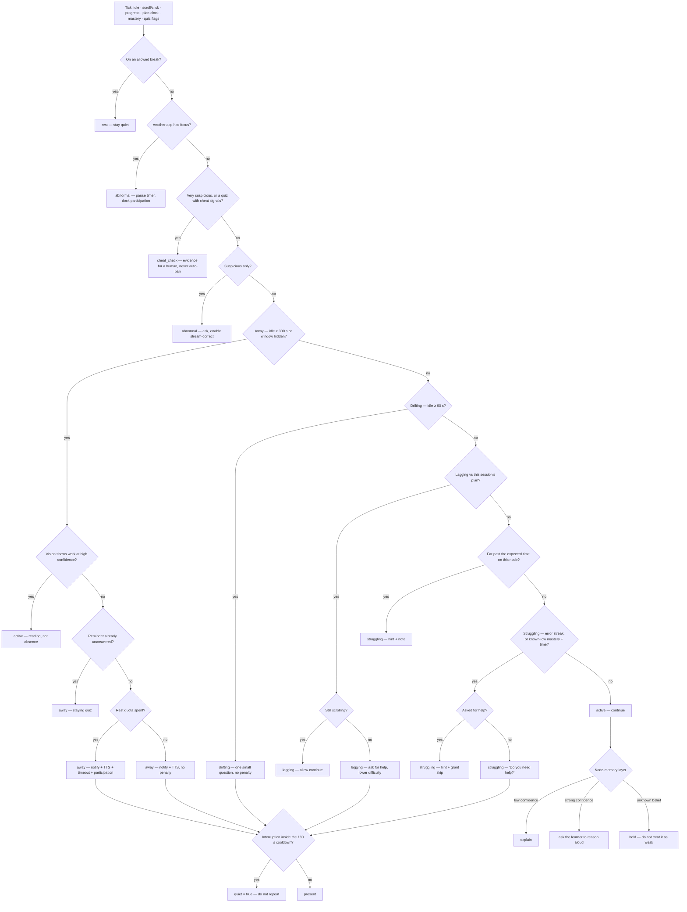

# The classroom decision engine

`app/harness/classroom.py` is the decision layer above `app/harness/attention.py`, and it is
built **on** `app/harness/teaching/supervision.py` rather than beside it.

- **Attention** answers *"is the learner on the task?"* — one reading, with evidence.
- **Supervision** answers *"should the tutor interrupt right now, and with what kind of move?"*
- **The classroom engine** answers *"given that reading, what exactly does the tutor do?"* —
  the full spec state machine, including the cheat-check evidence report.

It is **deterministic and offline**: the same snapshot always yields the same decision, no
model, no camera, no network. It reads a *vision verdict*, never a frame. Nothing is stored
and no grade is written.

## One source of truth

Both engines are mounted (`/api/v1/supervision` and `/api/v1/classroom/tick`). They cannot
contradict each other because the shared primitives are **imported from `supervision`**, not
copied:

| Shared primitive | Where it lives | Effect |
|------------------|----------------|--------|
| Idle thresholds | `supervision.IDLE_DRIFTING_SECONDS` (90 s), `IDLE_AWAY_SECONDS` (300 s) | drifting vs away |
| Hidden-window ratio | `supervision.HIDDEN_AWAY_RATIO` (0.60) | away while the window is hidden |
| **Notice cooldown** | `supervision.NOTICE_COOLDOWN_SECONDS` (180 s) | no nagging every tick |
| **Plan-relative progress** | `supervision.progress_reading` | lag vs this session's own clock, not a fixed `n` |
| Mastery band | `supervision.MASTERY_WEAK` (0.45) / `MASTERY_STRONG` (0.80) | explain vs ask-reason |
| **`mastery_known`** | `supervision.difficulty` | an unknown belief is not a weak one |
| Difficulty direction | `supervision.difficulty` | up → `inc`, down → `dec`, hold → `normal` |
| Participation | `supervision.participation` | a reading, reported on the decision |

The state vocabulary is aligned (`working`, `drifting`, `away`, `resting`, `struggling`,
plus `suspicious`), and `tests/test_classroom.py::test_classroom_and_supervision_agree_on_shared_states`
asserts the two engines return the same state on every shared scenario.

## The flow



## Branch priority (first match wins)

| # | Branch | Trigger | Move |
|---|--------|---------|------|
| 1 | `rest` | `on_break` | nothing — never disturb an allowed break |
| 2 | `abnormal` | `playing_other` | pause timer, dock participation, note (no accusation) |
| 3 | `cheat_check` | `very_suspicious`, or `on_quiz` + a conclusive signal | gather evidence; one signal never bans |
| 4 | `abnormal` | `suspicious` only | ask for the reasoning, enable stream-correct |
| 5 | `away` | idle ≥ 300 s or window hidden ≥ 60 % | vision first; notify + timeout → participation; staying quiz |
| 6 | `drifting` | idle ≥ 90 s | one small, answerable question; no penalty |
| 7 | `lagging` | behind the session's own plan | browsing → continue; stopped → help + lower difficulty |
| 8 | `struggling` | time-in-node far past expected | hint + note |
| 9 | `struggling` | error streak, or known-low mastery + time | ask for help; once asked → hint + skip |
| 10 | `active` | otherwise | continue, refined by the node-memory layer |

The **node-memory layer** is a modifier, not a branch:

- confidence **low** (< 0.45) → `explain`; on a quiz, `grant_skip`.
- confidence **strong** (≥ 0.80) → `ask_reason` ("explain it back to me").
- **`mastery_known` false** → hold: an unknown belief (no attempts yet) is not a weak one,
  so the engine neither explains nor lowers the difficulty.

It never overrides a safety action (`pause`, `cheat_check`, `quiz_stay`).

## Signals (all optional)

| Signal | Meaning |
|--------|---------|
| `idle_seconds` | time since the last interaction (the primary activity signal) |
| `scroll_events`, `click_events`, `selection_events`, `typing_events` | activity in the tick |
| `progress` | 0–1 completion of the current node |
| `elapsed_seconds`, `planned_seconds` | the session's own clock (plan-relative progress) |
| `progress_target` | fallback fixed threshold when no clock is supplied |
| `rest_quota`, `on_break` | allowed breaks remaining; whether the learner is on one |
| `seconds_in_node`, `expected_node_seconds` | time on the node vs the expected time |
| `node_confidence`, `mastery_known` | node-memory belief, and whether it is known at all |
| `on_quiz`, `suspicious`, `very_suspicious` | assessment context and suspicion level |
| `answer_speed_ratio` | actual time ÷ expected time (below `0.25` is inhuman) |
| `explained_procedure`, `solved_variant` | could they explain it? could they solve a variant? |
| `ai_trace`, `camera_suspicion` | cheat-check inputs |
| `error_streak`, `accuracy`, `help_requested` | struggle signals |
| `unanswered_reminders` | how many inactivity reminders already went unanswered |
| `last_notice_at`, `now` | the cooldown clock |
| `vision_state`, `vision_confidence` | the *reading* from `attention.assess`, never a frame |

## Actions, difficulty, cooldown

`continue`, `notify`, `ask`, `ask_help`, `quiz_stay`, `hint`, `grant_skip`, `explain`,
`ask_reason`, `cheat_check`, `adjust`, `pause`.

Adaptive difficulty is advisory (it moves the *next* item): `inc` when node memory is strong,
`dec` when it is known-weak or accuracy is poor, `normal` when unknown or mid.

`quiet: true` means the interruption falls inside the 180 s cooldown — the client should not
repeat it. Safety actions (`pause`, `cheat_check`) are never silenced.

## Route

```
POST /api/v1/classroom/tick
{ "signals": { "idle_seconds": 400, "rest_quota": 0, "node_confidence": 0.3 } }
```

Returns `{branch, state, action, tts, notification, hint, quiz, grant_skip, quiet,
participation_penalty, difficulty, cheat, participation, evidence, timers}`. The same body
always returns the same decision, so a client can replay a tick.
`/api/v1/harness/status` exposes `classroom.describe()` for the transparency panel.
